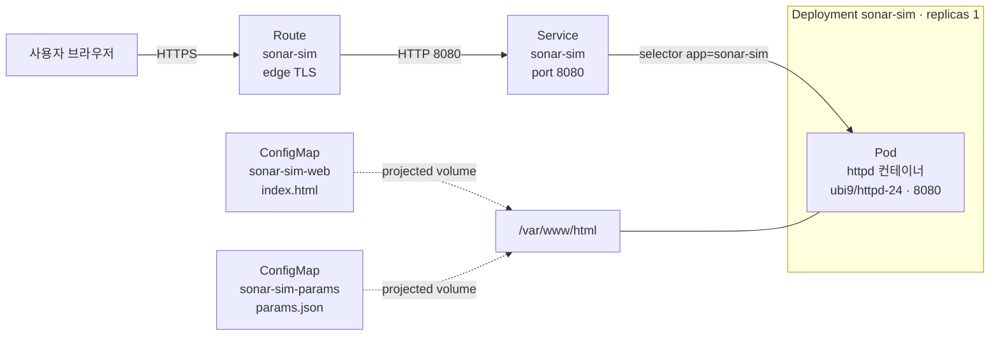
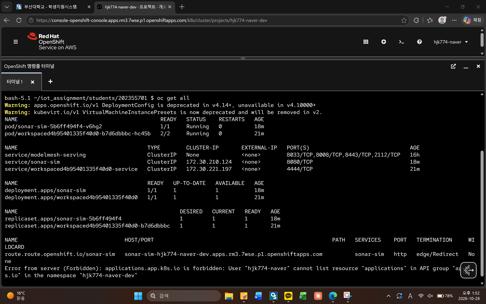
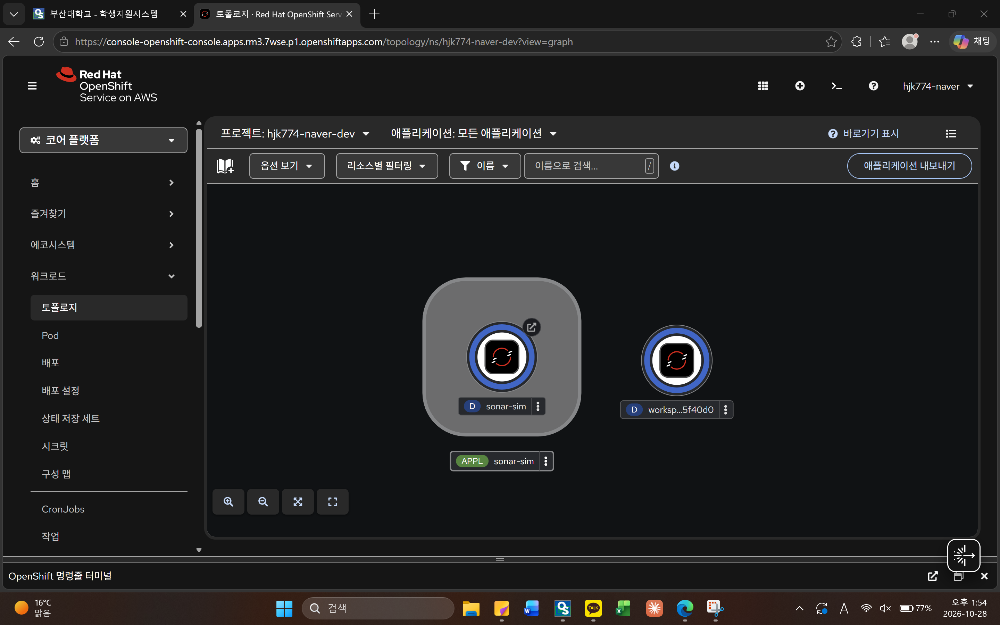
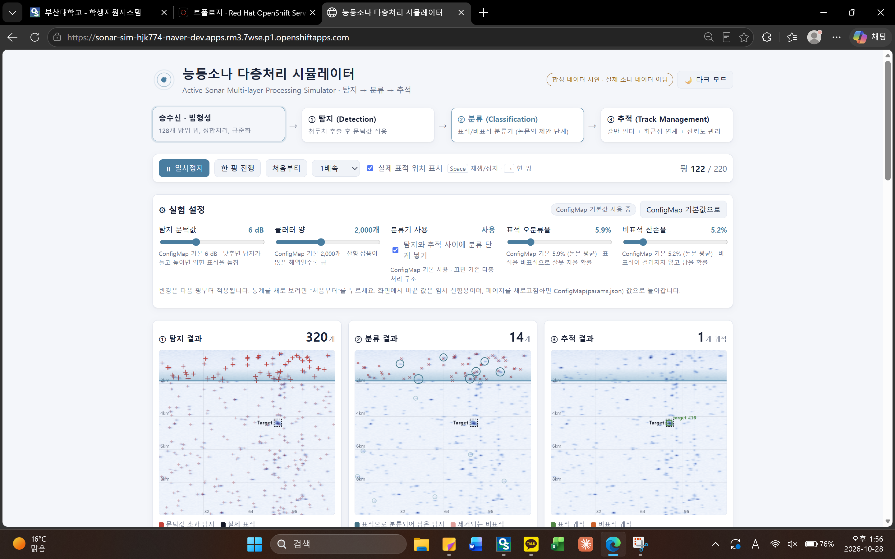
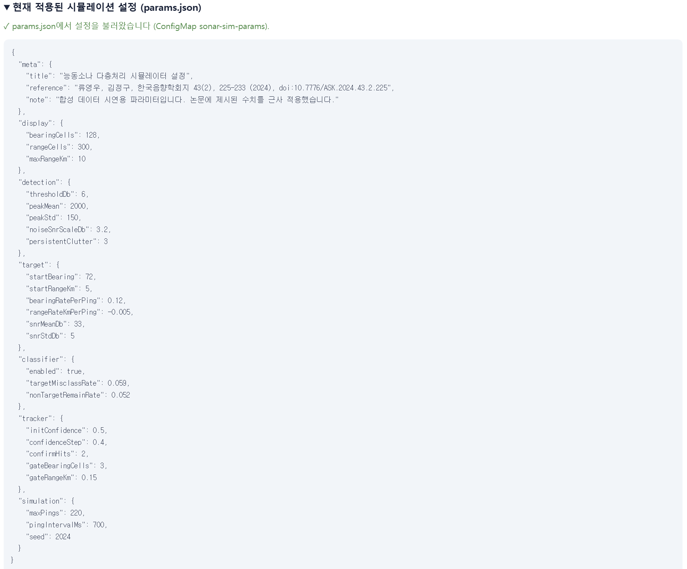
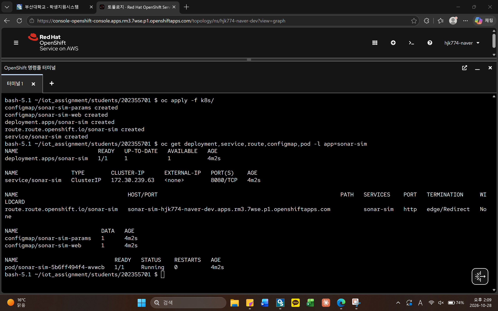

# 능동소나 다층처리 시뮬레이터 (Active Sonar Multi-layer Processing Simulator)

## 1. 컨테이너 소개

| 항목 | 내용 |
|---|---|
| 서비스 이름 | `sonar-sim` (능동소나 다층처리 시뮬레이터) |
| 한 줄 설명 | 능동소나 신호처리의 **탐지 → 분류 → 추적** 3단계를 합성 데이터로 시각화하는 웹 서비스 |
| 접속 방법 | Route 주소(https)로 브라우저에서 접속하면 바로 시뮬레이션이 재생됨 |

### 주제를 고른 이유

관심 분야인 류영우·김정구(2024)의 논문 「소수 불균형 데이터의 심층학습을 통한 능동소나 다층처리기의 표적 인식성 개선」[1]을 읽고, 논문이 제안한 처리 구조를 직접 눈으로 확인할 수 있는 서비스를 만들고 싶었습니다.

논문의 핵심은 다음과 같습니다. 능동소나는 표적이 1개라도 해저·해수면 잔향과 생물 소음 때문에 매 핑마다 수백 개의 비표적 탐지가 함께 생깁니다. 논문은 기존 구조(탐지 → 표적관리) 사이에 **CNN 기반 표적/비표적 분류기**를 추가해 비표적을 먼저 걸러내고, 그 결과를 칼만 필터 추적과 연계해 운용자가 표적을 쉽게 알아볼 수 있게 했습니다.

### 주요 기능

- **① 탐지 화면:** 잡음 첨두치 중 문턱값(6 dB)을 넘는 탐지를 적색 십자로 표시 (논문 Fig. 3)
- **② 분류 화면:** 분류기가 표적으로 판정한 탐지만 남김 (논문 Fig. 12)
- **③ 추적 화면:** 칼만 필터 + 최근접 연계 + 신뢰도 기반 궤적 관리 결과 (논문 Fig. 14)
- **통계:** 단계별 개수의 현재·최소·최대·평균 (논문 Table 8 형식), 분류기 적용/미적용 궤적 수 비교, 관측된 오분류율·잔존율
- **설정 분리:** 모든 시뮬레이션 파라미터를 ConfigMap(`params.json`)으로 분리해 이미지 변경 없이 동작을 바꿀 수 있음
- **핑 애니메이션:** 매 핑마다 거리 방향으로 내려가는 sweep 선을 따라 반향음이 거리 순서대로 나타남. 분류 화면에서는 제거되는 비표적이 × 표시로 사라지고, 추적 화면의 궤적은 이전 위치에서 새 위치로 부드럽게 이동함. 위쪽 처리 흐름 상자도 진행 단계에 맞춰 차례로 강조됨
- **실험 설정:** 문턱값, 클러터 양, 분류기 사용 여부, 표적 오분류율, 비표적 잔존율을 슬라이더로 바로 바꿔 볼 수 있음. 슬라이더의 초기값은 ConfigMap(`params.json`) 값이며, "ConfigMap 기본값으로" 버튼으로 되돌림. 화면에서 바꾼 값은 임시 실험용이고 새로고침하면 ConfigMap 값으로 돌아감 (운영 기본값 = ConfigMap, 화면 = 임시 실험)
- **분류기 효과 비교:** 분류기 적용(논문 제안 구조)과 미적용(기존 구조)의 추적 결과를 나란히 표시하고, 평균 궤적 수가 몇 분의 1로 줄었는지 계산해 보여줌
- **탐지 클릭 상세보기:** ① 또는 ② 화면의 탐지를 클릭하면 실제 정체, 분류 결과, 정분류/오분류 여부, SNR, 위치와 함께 탐지 주변의 방위 15 × 거리 25 셀 에너지 분포 영상(논문 Fig. 5 형식)을 같은 핑의 실제 표적 영상과 비교해 보여줌
- **라이트/다크 테마:** 우측 상단 버튼으로 전환 (기본 라이트, 브라우저에 선택 기억)
- **재생 조작:** 재생/일시정지, 한 핑씩 진행, 처음부터, 0.5~4배속, 실제 표적 위치 표시 on/off, 키보드 단축키(Space 재생/정지, → 한 핑)
- **접근성:** 운영체제에서 "동작 줄이기"를 켠 사용자에게는 애니메이션 없이 결과만 표시

### 데이터 구현 방식: 논문 원본 데이터를 쓸 수 없어 합성 데이터로 구현

> ⚠ **이 서비스는 교육용 시연입니다.** 화면의 모든 탐지·표적 데이터는 브라우저에서 생성한 합성 데이터이며, 실제 소나 데이터나 학습된 CNN 모델은 사용하지 않습니다.

**처음 계획과 문제점**

처음에는 논문의 실험 데이터로 탐지 → 분류 → 추적 결과를 그대로 재현하려고 했습니다. 하지만 논문의 데이터는 국방과학연구소가 동해 해상실험에서 획득한 능동소나 자료로, **보안상의 이유로 공개되지 않아 정확한 데이터 수치를 확보할 수 없었습니다.** 학습된 CNN 분류기와 핑별 탐지 원시값도 공개되지 않았고, 논문에는 처리 구조와 요약 통계만 실려 있습니다. 또한 Developer Sandbox는 자원이 제한된 공유 환경이라 CNN 모델을 학습·실행하는 서비스는 과제 안내문에서도 피하도록 권장하고 있습니다.

**해결 방법: 공개된 구조와 요약 수치만 가져오고, 데이터는 직접 생성**

논문에 공개된 **처리 구조와 요약 수치**만 파라미터로 가져오고, 실제 데이터 대신 비슷한 통계적 특성을 갖는 합성 데이터를 브라우저에서 만들었습니다.

| 구성 요소 | 논문에서 가져온 내용 | 시뮬레이터 구현 방식 |
|---|---|---|
| 화면 형식 | 방위 128개 × 거리 축의 탐지 화면 (Fig. 3) | 방위 128셀 × 거리 300셀(0~10 km) 에너지 분포를 핑마다 생성 |
| 탐지 | 문턱값 6 dB (Ⅱ장), 핑당 수백 개의 비표적 탐지 | 잡음 첨두치 약 2,000개를 지수분포 SNR로 만들고 6 dB 이상만 남김 → 핑당 평균 약 300개 |
| 지속성 클러터 | 해저·해수면 잔향 등 같은 위치에서 반복되는 비표적 | 고정 위치 클러터 3개를 확률적으로 반복 생성 |
| 표적 | 실제 표적 1개 | 등속 이동하는 표적 1개 (SNR 평균 33 dB, 임의 설정) |
| 분류기 | CNN 분류기 200개 중 선택, 평균 표적 오분류율 5.9%, 비표적 잔존율 5.2% (Table 3) | CNN 대신 탐지마다 이 확률로 유지/제거를 판정 |
| 분류 입력 영상 | 방위 15 × 거리 25 픽셀 에너지 분포 영상 (Fig. 5) | 합성 에너지 분포에서 같은 크기로 잘라 탐지 클릭 상세보기에 표시 |
| 추적 | 칼만 필터 + 최근접 연계, 신뢰도 초기 0.5, 증감 0.4, 0이 되면 삭제 (4.3절) | 같은 규칙으로 구현 (방위·거리 축별 등속 칼만 필터) |
| 결과 비교 기준 | Table 8 (세트 1, 74핑): 탐지 평균 284개, 분류 후 7.4개, 궤적 3.4개 | 5장 결과 해석에서 비교 |

이 값들은 모두 ConfigMap(`params.json`)에 모아 두었습니다. 그래서 다른 해역 조건이나 분류기 성능을 가정해 값만 바꿔 다시 배포할 수 있습니다.

**한계:** 합성 데이터이므로 실제 해역의 잔향 분포나 표적 반향 특성과는 다릅니다. 이 시뮬레이터는 논문의 성능을 검증하는 것이 아니라, **분류 단계를 추가했을 때 운용자 화면의 궤적 수가 얼마나 줄어드는지라는 처리 구조의 효과**를 보여 주는 것이 목적입니다.

## 2. 아키텍처

### 2.1 OpenShift 구성도



**요청 흐름:** 사용자 → Route(외부 HTTPS 주소, TLS 종료) → Service(내부 고정 주소, label로 Pod 선택) → Pod(httpd가 `/var/www/html`의 파일 제공) → 브라우저가 `index.html`을 실행하고 `params.json`을 읽어 시뮬레이션 수행

### 2.2 시뮬레이터 내부 처리 흐름 (논문 Fig. 4 대응)


### 2.3 사용한 Object와 역할

| Object | 이름 | 역할 |
|---|---|---|
| Deployment | `sonar-sim` | httpd 컨테이너 1개를 실행·유지. resources, Probe, 보안 설정, 볼륨 마운트 정의 |
| Service | `sonar-sim` | `app: sonar-sim` label을 가진 Pod에 8080 포트로 연결되는 내부 고정 주소 |
| Route | `sonar-sim` | 외부에서 접속하는 HTTPS 주소. edge TLS 종료, http 요청은 https로 리다이렉트 |
| ConfigMap | `sonar-sim-web` | 웹페이지(`index.html`). 이미지를 빌드하지 않고 웹 콘텐츠를 주입 |
| ConfigMap | `sonar-sim-params` | 시뮬레이션 설정(`params.json`). 웹페이지와 설정을 분리해 설정만 바꿔 동작 변경 가능 |
| Liveness Probe | (Deployment 내부) | `/index.html` 응답 확인. 실패가 계속되면 컨테이너 재시작 |
| Readiness Probe | (Deployment 내부) | `/params.json` 응답 확인. 설정 파일까지 정상 제공될 때만 Service가 트래픽 전달 |

**projected 볼륨을 쓴 이유:** ConfigMap 두 개를 각각 같은 디렉터리에 마운트하면 하나가 다른 하나를 덮어씁니다. projected 볼륨은 여러 ConfigMap을 **하나의 디렉터리로 합쳐** 마운트할 수 있어서, `/var/www/html` 안에 `index.html`과 `params.json`이 함께 들어갑니다.

### 2.4 YAML 주요 항목 설명

| 파일 | 항목 | 설명 |
|---|---|---|
| deployment.yaml | `selector.matchLabels` / `template.metadata.labels` | Deployment가 관리할 Pod를 `app: sonar-sim`으로 찾음. 두 값이 같아야 함 |
| deployment.yaml | `resources.requests` / `limits` | 최소 보장 CPU 50m·메모리 64Mi, 최대 CPU 200m·메모리 256Mi. Sandbox 할당량 초과 방지 |
| deployment.yaml | `securityContext` | 권한 상승 금지, 비루트 실행, 모든 커널 권한 제거, 기본 seccomp. OpenShift `restricted-v2` 정책에 맞춤 |
| deployment.yaml | `volumeMounts.readOnly: true` | 웹 콘텐츠는 읽기 전용으로 마운트 |
| service.yaml | `ports.port` / `targetPort` | Service가 받는 포트(8080)와 Pod에 전달할 포트(8080) |
| route.yaml | `to.name` | 연결할 Service 이름 |
| route.yaml | `port.targetPort: http` | Service의 `http` 이름 포트로 전달 |
| route.yaml | `tls.termination: edge` | Router에서 HTTPS를 처리하고 Pod로는 HTTP로 전달 |
| 모든 파일 | `app.kubernetes.io/part-of` | 웹 콘솔 Topology 화면에서 관련 리소스를 한 그룹으로 묶어 표시 |

## 3. 사용 이미지

| 항목 | 내용 |
|---|---|
| 이미지 | `registry.access.redhat.com/ubi9/httpd-24:latest` |
| 노출 포트 | 8080 (HTTP) |
| 콘텐츠 경로 | `/var/www/html` |

**선택한 이유**

- **비루트 실행 지원:** OpenShift는 컨테이너를 임의의 비루트 UID로 실행합니다. Red Hat UBI 이미지는 이 환경을 전제로 만들어져 Permission denied 오류가 나지 않습니다.
- **1024 이상 포트 사용:** 기본으로 8080 포트를 사용하므로 비루트 사용자의 80 포트 바인딩 오류(`bind: permission denied`)가 생기지 않습니다.
- **다운로드 제한 없음:** Docker Hub가 아닌 `registry.access.redhat.com` 이미지라 `toomanyrequests` 오류를 피할 수 있습니다.
- **가벼움:** 정적 파일만 제공하고 시뮬레이션 계산은 모두 브라우저에서 하므로 서버 자원을 거의 쓰지 않습니다.

## 4. 배포 방법

```bash
# 1. 로그인 (웹 콘솔 계정 메뉴 → Copy login command)
oc login --token=<토큰> --server=<서버주소>

# 2. 프로젝트 확인
oc project

# 3. 배포 (students/202355701 폴더에서 실행)
oc apply -f k8s/

# 4. 확인
oc get pods                 # 1/1 Running
oc get endpoints sonar-sim  # Pod IP:8080 연결
oc get route sonar-sim      # 접속 주소

# 5. 배포 리소스만 조회 (ConfigMap 포함)
oc get deployment,service,route,configmap,pod -l app=sonar-sim
```

Kubernetes 1.33 이상에서는 `oc get endpoints` 실행 시 deprecated 경고가 나옵니다. 결과에는 영향이 없으며, 경고 없이 보려면 `oc get endpointslices -l kubernetes.io/service-name=sonar-sim`을 사용합니다.

**실제로 수행한 방법 (웹 콘솔 터미널)**

이번 배포는 OpenShift 웹 콘솔 오른쪽 위의 `>_` 명령줄 터미널에서 진행했습니다. 웹 터미널에는 `oc`가 설치되어 있고 로그인도 되어 있어 별도 설치가 필요 없습니다. GitHub 저장소를 그대로 받아 배포하므로 채점 방식과 같은 조건으로 확인할 수 있습니다.

```bash
git clone https://github.com/juhoKang-124/iot_assignment.git
cd iot_assignment/students/202355701
oc project          # hjk774-naver-dev 확인
oc apply -f k8s/
```

**접속 경로와 예상 화면**

- 브라우저에서 `https://<oc get route 에 나온 HOST>` 로 접속합니다.
- 상단에 처리 흐름(송수신 → 탐지 → 분류 → 추적)이 보이고, 세 개의 방위-거리 화면에서 시뮬레이션이 자동 재생됩니다.
- ① 탐지 화면에는 약 300개, ② 분류 화면에는 약 15~20개, ③ 추적 화면에는 표적 궤적을 포함한 2~3개의 궤적이 보입니다.
- 페이지 아래 "현재 적용된 시뮬레이션 설정"을 펼쳤을 때 **"✓ params.json에서 설정을 불러왔습니다"** 가 보이면 ConfigMap이 정상 마운트된 것입니다.

```bash
# curl로 확인
curl -s https://<HOST>/params.json        # 설정 JSON
curl -sI https://<HOST>/ | head -1        # HTTP/1.1 200 OK
```

**재현성 확인 (채점 방식과 동일)**

```bash
oc delete -f k8s/
oc apply -f k8s/
```

**설정 바꿔 보기:** `k8s/configmap-params.yaml`에서 `"enabled": true`를 `false`로 바꾸고 `oc apply -f k8s/`를 실행한 뒤 페이지를 새로고침하면, 분류 단계가 꺼져 ③ 추적 화면이 비표적 궤적으로 가득 차는 것을 볼 수 있습니다. 이미지나 Deployment는 그대로이고 ConfigMap만 바뀝니다. ConfigMap을 환경변수가 아닌 **볼륨으로 마운트**했기 때문에 Pod를 재시작하지 않아도 파일 내용이 갱신됩니다. 다만 kubelet이 변경을 반영하기까지 최대 1분 정도 걸릴 수 있습니다 (환경변수 방식이었다면 Pod 재시작이 필요).

**문제가 생겼을 때 확인 순서 (수업 실습 매뉴얼 방식)**

```bash
oc get pods                                           # 상태, 재시작 횟수
oc describe pod -l app=sonar-sim | grep -A 3 Warning  # 경고 이벤트
oc logs deploy/sonar-sim                              # httpd 로그
oc get endpoints sonar-sim                            # Service-Pod 연결
oc describe quota                                     # 할당량
oc rollout undo deployment/sonar-sim                  # 이전 버전으로 복구
```

## 5. 배포 결과

### 5.1 배포 환경

| 항목 | 내용 |
|---|---|
| 클러스터 | Red Hat OpenShift Service on AWS (Developer Sandbox, OpenShift 4.21) |
| 프로젝트 | `hjk774-naver-dev` |
| 배포 방법 | 웹 콘솔 명령줄 터미널에서 `git clone` → `oc apply -f k8s/` |
| Route 주소 | https://sonar-sim-hjk774-naver-dev.apps.rm3.7wse.p1.openshiftapps.com (Sandbox 사용 기간이 끝나면 접속되지 않을 수 있음) |

### 5.2 oc get all 출력



```text
$ oc get all
Warning: apps.openshift.io/v1 DeploymentConfig is deprecated in v4.14+, unavailable in v4.10000+
Warning: kubevirt.io/v1 VirtualMachineInstancePresets is now deprecated and will be removed in v2.
NAME                                            READY   STATUS    RESTARTS   AGE
pod/sonar-sim-5b6ff494f4-v6hg2                  1/1     Running   0          18m
pod/workspaced4b95401335f40d0-b7d6dbbbc-hc45b   2/2     Running   0          21m

NAME                                        TYPE        CLUSTER-IP       EXTERNAL-IP   PORT(S)                               AGE
service/modelmesh-serving                   ClusterIP   None             <none>        8033/TCP,8008/TCP,8443/TCP,2112/TCP   16h
service/sonar-sim                           ClusterIP   172.30.210.124   <none>        8080/TCP                              18m
service/workspaced4b95401335f40d0-service   ClusterIP   172.30.221.197   <none>        4444/TCP                              21m

NAME                                        READY   UP-TO-DATE   AVAILABLE   AGE
deployment.apps/sonar-sim                   1/1     1            1           18m
deployment.apps/workspaced4b95401335f40d0   1/1     1            1           21m

NAME                                                  DESIRED   CURRENT   READY   AGE
replicaset.apps/sonar-sim-5b6ff494f4                  1         1         1       18m
replicaset.apps/workspaced4b95401335f40d0-b7d6dbbbc   1         1         1       21m

NAME                                 HOST/PORT                                                       PATH   SERVICES    PORT   TERMINATION     WILDCARD
route.route.openshift.io/sonar-sim   sonar-sim-hjk774-naver-dev.apps.rm3.7wse.p1.openshiftapps.com          sonar-sim   http   edge/Redirect   None
Error from server (Forbidden): applications.app.k8s.io is forbidden: User "hjk774-naver" cannot list resource "applications" in API group "app.k8s.io" in the namespace "hjk774-naver-dev"
```

- **이 과제의 리소스:** `pod/sonar-sim`(1/1 Running, 재시작 0), `service/sonar-sim`(8080/TCP), `deployment.apps/sonar-sim`(1/1), `replicaset.apps/sonar-sim`, `route/sonar-sim`(edge/Redirect)
- **과제와 무관한 리소스:** `workspace...`는 웹 콘솔 명령줄 터미널 자체의 Pod·Service이고, `modelmesh-serving`은 Sandbox 프로젝트에 기본으로 있는 서비스입니다.
- **Warning·Forbidden 메시지:** 6장 경고 메시지 분석에 정리했습니다. 배포 결과와는 무관합니다.

### 5.3 Topology 화면



`APPL sonar-sim` 그룹 안에 Deployment `sonar-sim`이 표시됩니다. 모든 YAML에 넣은 `app.kubernetes.io/part-of: sonar-sim` 라벨 덕분에 관련 리소스가 하나의 애플리케이션으로 묶였습니다. 원 오른쪽 위의 ↗ 아이콘이 Route 주소로 연결됩니다.

### 5.4 브라우저 접속 화면



Route 주소(`https://sonar-sim-hjk774-naver-dev...`)로 접속한 화면입니다. 주소창에 HTTPS가 적용되어 있고, 시뮬레이터가 핑 122/220까지 정상 재생되고 있습니다.

### 5.5 ConfigMap 적용 확인



페이지 하단에 **"✓ params.json에서 설정을 불러왔습니다 (ConfigMap sonar-sim-params)."**가 표시되고, ConfigMap에 넣은 설정 JSON이 그대로 보입니다. 웹페이지(`sonar-sim-web`)와 설정(`sonar-sim-params`) ConfigMap 두 개가 projected 볼륨으로 `/var/www/html`에 함께 마운트되어 정상 제공된다는 증거입니다. Readiness Probe도 같은 `/params.json` 경로를 확인합니다.

### 5.6 재현성 검증 (`oc delete` → `oc apply`)

채점 방식과 같게 리소스를 모두 삭제한 뒤 `k8s/` 폴더의 YAML만으로 다시 배포했습니다.

```bash
oc delete -f k8s/
oc get deployment,service,route,configmap,pod -l app=sonar-sim   # No resources found
oc apply -f k8s/
oc get deployment,service,route,configmap,pod -l app=sonar-sim
```



```text
$ oc apply -f k8s/
configmap/sonar-sim-params created
configmap/sonar-sim-web created
deployment.apps/sonar-sim created
route.route.openshift.io/sonar-sim created
service/sonar-sim created

$ oc get deployment,service,route,configmap,pod -l app=sonar-sim
NAME                        READY   UP-TO-DATE   AVAILABLE   AGE
deployment.apps/sonar-sim   1/1     1            1           4m2s

NAME                TYPE        CLUSTER-IP      EXTERNAL-IP   PORT(S)    AGE
service/sonar-sim   ClusterIP   172.30.239.63   <none>        8080/TCP   4m2s

NAME                                 HOST/PORT                                                       PATH   SERVICES    PORT   TERMINATION     WILDCARD
route.route.openshift.io/sonar-sim   sonar-sim-hjk774-naver-dev.apps.rm3.7wse.p1.openshiftapps.com          sonar-sim   http   edge/Redirect   None

NAME                         DATA   AGE
configmap/sonar-sim-params   1      4m2s
configmap/sonar-sim-web      1      4m2s

NAME                             READY   STATUS    RESTARTS   AGE
pod/sonar-sim-5b6ff494f4-wvwcb   1/1     Running   0          4m2s
```

| 항목 | 처음 배포 | 재배포 후 |
|---|---|---|
| Pod 이름 | `sonar-sim-5b6ff494f4-v6hg2` | `sonar-sim-5b6ff494f4-wvwcb` |
| Service ClusterIP | `172.30.210.124` | `172.30.239.63` |
| 생성 시간(AGE) | 18m | 5개 리소스 모두 4m2s |
| Route 주소 | 같음 | 같음 (host를 지정하지 않아 같은 규칙으로 다시 생성) |

Pod 이름과 Service IP가 바뀌고 5개 리소스의 생성 시간이 같으므로, 기존 리소스가 지워지고 **`k8s/` 폴더의 YAML만으로 전부 다시 만들어졌음**을 확인했습니다. 재배포 후에도 브라우저에서 같은 주소로 정상 접속되었습니다.

### 결과 해석

220핑 전체를 실행했을 때 단계별 개수는 다음과 같습니다 (seed 2024 기준).

| 구분 | 최소 | 최대 | 평균 |
|---|---|---|---|
| 탐지 | 244 | 414 | 308.7 |
| 분류 후 | 6 | 29 | 16.6 |
| 궤적 (분류기 적용) | 1 | 7 | 2.6 |
| 궤적 (분류기 미적용) | 92 | 371 | 308.2 |

논문 Table 8(세트 1, 74핑)과 평균값을 비교하면 다음과 같습니다.

| 구분 | 논문 Table 8 평균 | 시뮬레이터 평균 |
|---|---|---|
| 탐지 | 284 | 308.7 |
| 분류 후 | 7.4 | 16.6 |
| 궤적 | 3.4 | 2.6 |

분류기를 적용하면 운용자에게 보이는 궤적이 평균 2~3개로 줄어 논문의 결과(평균 3.4개)와 비슷한 경향을 보입니다. 분류 후 개수가 논문보다 많은 것은 시뮬레이터가 논문 Table 3의 **200개 분류기 평균 잔존율(5.2%)**을 모든 탐지에 똑같이 적용했기 때문입니다. 논문은 그중 추적에 쓸 분류기를 따로 골랐고 실제 해역 데이터를 썼기 때문에 값이 다릅니다. 반대로 분류기 없이 탐지 결과를 바로 추적하면 비표적 밀도가 너무 높아 거의 모든 탐지가 궤적으로 확정됩니다. 이는 논문이 지적한 "과도한 비표적 탐지 환경에서는 추적 기법만으로 개선에 한계가 있다"는 점을 보여 줍니다.

## 6. 어려웠던 점

### 6.1 논문 데이터를 확보할 수 없었던 문제

주제로 정한 논문의 실험 데이터는 국방 해상실험 자료라 보안상 공개되지 않아, 정확한 수치를 확보할 수 없었습니다. 논문을 그대로 재현하는 대신, 공개된 처리 구조와 요약 통계(문턱값, 분류기 평균 성능, 추적 신뢰도 규칙)만 가져오고 데이터는 합성해서 구현했습니다. 자세한 내용은 1장 "데이터 구현 방식"에 정리했습니다.

### 6.2 단계별 경고·오류 메시지 분석

과제를 진행하며 나온 메시지를 단계 순서대로 정리했습니다. 실제로 조치가 필요했던 것은 Git push 403 오류 하나였고, 나머지는 정상 동작 중에 나오는 안내 메시지였습니다.

| 단계 | 메시지 | 원인 분석 | 조치 및 결과 |
|---|---|---|---|
| Git 커밋 (`git add`) | `warning: in the working copy of '...', LF will be replaced by CRLF the next time Git touches it` | Windows용 Git의 줄바꿈 자동 변환(`core.autocrlf`) 안내. 파일은 리눅스식 줄바꿈(LF)으로 만들어졌고, Windows 작업 폴더에서는 CRLF로 바뀔 수 있다는 뜻 | 저장소에는 LF로 저장되고 YAML 해석에도 영향이 없어 그대로 진행 |
| Git 원격 연결 (`git pull origin main`) | `fatal: couldn't find remote ref main` | GitHub에 새로 만든 저장소가 비어 있어 받아올 `main` 브랜치가 아직 없음 | pull 없이 첫 커밋을 push하면 `main` 브랜치가 생성됨 |
| Git push | `remote: Permission to kang774-coder/iot_assignment.git denied to juhoKang-124.` `The requested URL returned error: 403` | 원격 저장소 경로와 PC에 저장된 GitHub 로그인 계정이 서로 다름 | 6.3에서 원격 경로를 바꿔 해결 |
| Sandbox 시작 | `Your account needs manual approval` | 새로 가입한 계정이 Developer Sandbox 관리자 승인 대기 상태 | 잠시 후 다시 접속하자 승인되어 `hjk774-naver-dev` 프로젝트가 생성됨 |
| `oc project` | `... on server "https://172.30.0.1:443"` | 오류 아님. 웹 터미널이 클러스터 **안에서** 실행되어 API 서버의 내부 주소로 연결된 것 | 프로젝트가 `hjk774-naver-dev`로 맞게 선택된 것만 확인 |
| `oc get pods` (배포 직후) | `0/1 ContainerCreating` | 이미지를 내려받고 ConfigMap 볼륨을 붙이는 중 | 수십 초 뒤 `1/1 Running`. 함께 보인 `workspace...` Pod는 웹 터미널 자체 |
| `oc get endpoints` | `Warning: v1 Endpoints is deprecated in v1.33+; use discovery.k8s.io/v1 EndpointSlice` | 조회에 쓰는 v1 Endpoints API가 Kubernetes 1.33부터 구식이 되었다는 안내. 제출한 YAML에는 Endpoints 리소스가 없음 | 결과 `10.128.17.0:8080`으로 Readiness 통과와 Service-Pod 연결을 확인. 경고 없는 조회는 `oc get endpointslices` |
| `oc get all` | `DeploymentConfig is deprecated`, `VirtualMachineInstancePresets is now deprecated` 경고와 `Error from server (Forbidden): applications.app.k8s.io is forbidden` | `oc get all`이 여러 리소스 종류를 한꺼번에 조회하면서, 구식이 된 종류와 Sandbox 일반 사용자에게 조회 권한이 없는 종류에서 나온 메시지 | sonar-sim 리소스는 정상 조회됨. 조회할 종류를 직접 지정(`oc get deployment,service,route,configmap,pod -l app=sonar-sim`)하면 메시지 없이 확인 가능 |
| 재배포 중 삭제 확인 (`oc get all -l app=sonar-sim`) | `No resources found` 대신 위 Forbidden 오류만 출력 | 권한 오류가 출력되면서 "결과 없음" 문구가 표시되지 않아 삭제가 실패한 것처럼 보임 | 종류를 지정한 조회로 삭제를 확인한 뒤 `oc apply` 진행 |

### 6.3 Git 원격 저장소 경로와 로그인 계정 불일치 해결 (계정 전환)

- **상황:** 처음에는 원격 저장소를 `https://github.com/kang774-coder/iot_assignment.git`로 등록(`git remote add origin ...`)하고 push했는데, `denied to juhoKang-124` 메시지와 함께 403 오류가 났습니다.
- **원인:** Windows 자격 증명 관리자에 다른 GitHub 계정(`juhoKang-124`)의 로그인 정보가 저장되어 있었습니다. Git은 저장된 계정으로 인증했고, 그 계정은 원격 경로에 적힌 `kang774-coder` 소유 저장소에 쓰기 권한이 없었습니다. 즉 **원격 저장소 경로(remote URL)의 소유 계정과 실제 인증 계정이 달라서** 생긴 문제였습니다.
- **검토한 해결 방법**
  1. 원격 URL에 계정 이름을 넣어(`https://kang774-coder@github.com/...`) 해당 계정으로 다시 로그인
  2. Windows 자격 증명 관리자에서 저장된 GitHub 로그인 정보를 지우고 다시 로그인
  3. `kang774-coder` 저장소에 `juhoKang-124`를 Collaborator로 초대
  4. 이미 로그인된 `juhoKang-124` 계정에 과제 저장소를 새로 만들기
- **선택한 방법:** 4번을 선택했습니다. `juhoKang-124` 계정에 `iot_assignment` 저장소(Public)를 새로 만들고, 원격 경로만 바꿨습니다.

  ```powershell
  git remote set-url origin https://github.com/juhoKang-124/iot_assignment.git
  git push -u origin main
  ```

  이미 만든 커밋은 그대로 두고 원격 경로만 바꾸면 되므로 다시 커밋할 필요가 없었고, 바로 push에 성공했습니다.
- **배운 점:** Git 인증 오류가 나면 `git remote -v`로 원격 경로를 확인하고, 그 경로의 소유 계정과 PC에 로그인된 계정이 같은지부터 봐야 합니다.

### 6.4 설계하면서 고민한 점: ConfigMap 두 개를 한 경로에 넣기

웹페이지와 설정을 각각의 ConfigMap으로 나누고 싶었지만, 두 ConfigMap을 같은 디렉터리(`/var/www/html`)에 각각 마운트하면 하나가 다른 하나를 덮어씁니다. projected 볼륨으로 두 ConfigMap을 하나의 디렉터리로 합쳐 해결했습니다.

## 7. AI·참고자료 활용 내역

**역할 구분**

| 작업 | 수행 |
|---|---|
| 논문 내용 정리와 주제 범위 결정 | 본인 |
| 합성 데이터 시뮬레이터 구현 (논문 원본 데이터를 확보할 수 없어 논문 재현 대신 합성 데이터로 구현) | Claude |
| 시뮬레이터 HTML/JS 작성 | Claude |
| Deployment·Service·Route·ConfigMap YAML 작성 | Claude |
| 수업 자료와 YAML 대조 점검 | Claude |
| 단계별 경고·오류 메시지 분석 | 본인이 분석하고 Claude가 검증 |
| README 초안 작성 | Claude |
| Developer Sandbox 배포, 재배포 확인, 결과 캡처 | 본인 |

**AI 도구**

| 도구 | 용도 |
|---|---|
| Claude (Anthropic) | 합성 데이터 시뮬레이터 구현(논문 재현 대신 합성 데이터로 구현), 시뮬레이터 HTML/JS 작성, Deployment·Service·Route·ConfigMap YAML 작성, 수업 자료와 YAML 대조 점검, 단계별 경고·오류 메시지 분석 결과 검증, README 초안 작성 |

AI가 작성한 YAML은 본인 Developer Sandbox(`hjk774-naver-dev`)에 직접 배포해 Pod Running과 Route 접속을 확인했고, `oc delete -f k8s/` 후 `oc apply -f k8s/`로 재배포해 다시 정상 동작하는 것까지 확인했습니다(5.6절). YAML의 각 항목이 하는 일은 2.4절에 정리해 두었습니다.

**참고자료**

1. 류영우, 김정구, "소수 불균형 데이터의 심층학습을 통한 능동소나 다층처리기의 표적 인식성 개선," 한국음향학회지, 43(2), 225-233 (2024). https://doi.org/10.7776/ASK.2024.43.2.225
   - 시뮬레이터의 처리 구조(Fig. 4), 문턱값 6 dB(Ⅱ장), 분류기 평균 성능(Table 3), 추적 신뢰도 설정(4.3절)을 참고했습니다.
2. Red Hat Ecosystem Catalog, Apache httpd 2.4 (ubi9/httpd-24) 이미지 설명. https://catalog.redhat.com/software/containers/rhel9/httpd-24/61a60c2ec17162a20c1c6a5b
3. sclorg/httpd-container (이미지 Dockerfile: 8080 포트, `run-httpd` 실행). https://github.com/sclorg/httpd-container
4. 부산대학교 지능형IoT플랫폼 수업 자료
   - 제3강 3-2 「컨테이너 왜 대세가 되었나(실습 포함)」: Developer Sandbox 가입 절차
   - 제5강 5-2 「OpenShift 실습(2)」: Resource Limits, Liveness·Readiness Probe, ConfigMap 주입 방식
   - 「OpenShift Kubernetes 핸즈온 워크샵 매뉴얼」: Route 생성, Requests/Limits, Probe 설정, 문제 확인 명령
   - 「나만의 컨테이너 만들기」 과제 안내문: 이미지 선택 기준, 자주 발생하는 오류
5. Red Hat Developer Sandbox FAQ (계정 인증 관련). https://developers.redhat.com/developer-sandbox/FAQ
6. Kubernetes 문서, EndpointSlices (Endpoints deprecated 경고 확인). https://kubernetes.io/docs/concepts/services-networking/endpoint-slices/

---

## 부록: 폴더 구조

```text
students/202355701/
├── README.md
├── k8s/                       # 채점 대상 (oc apply -f k8s/)
│   ├── configmap-web.yaml     # index.html
│   ├── configmap-params.yaml  # params.json
│   ├── deployment.yaml
│   ├── service.yaml
│   └── route.yaml
├── src/                       # ConfigMap에 들어간 원본 파일 (편집용)
│   ├── index.html
│   └── params.json
└── images/                    # 배포 결과 캡처
    ├── oc_get_all.png         # oc get all 출력
    ├── topology.png           # 웹 콘솔 Topology 화면
    ├── browser.png            # Route 주소 접속 화면
    ├── configmap-loaded.png   # ConfigMap 설정 적용 확인
    └── redeploy.png           # oc delete → oc apply 재배포 결과
```

`src/`의 파일을 수정한 경우 ConfigMap YAML에도 같은 내용을 반영해야 실제 배포에 적용됩니다. `oc create configmap sonar-sim-web --from-file=index.html=src/index.html --dry-run=client -o yaml`로 다시 만들 수 있으며, 이때 생기는 `creationTimestamp: null` 줄은 지우고 `labels`를 다시 넣어 주세요.
