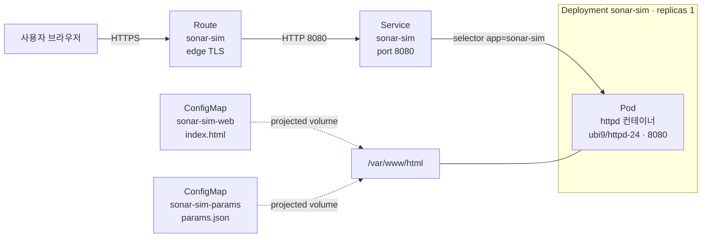

# 능동소나 다층처리 시뮬레이터 (Active Sonar Multi-layer Processing Simulator)

> 지능형IoT플랫폼 · 나만의 컨테이너 만들기 과제 · 202355701

## 1. 컨테이너 소개

| 항목 | 내용 |
|---|---|
| 서비스 이름 | `sonar-sim` (능동소나 다층처리 시뮬레이터) |
| 한 줄 설명 | 능동소나 신호처리의 **탐지 → 분류 → 추적** 3단계를 합성 데이터로 시각화하는 웹 서비스 |
| 접속 방법 | Route 주소(https)로 브라우저에서 접속하면 바로 시뮬레이션이 재생됨 |

### 주제를 고른 이유

관심 분야인 류영우·김정구(2024)의 논문 「소수 불균형 데이터의 심층학습을 통한 능동소나 다층처리기의 표적 인식성 개선」[1]을 읽고, 논문이 제안한 처리 구조를 직접 눈으로 확인할 수 있는 서비스를 만들고 싶었습니다.

논문의 핵심은 다음과 같습니다. 능동소나는 표적이 1개라도 해저·해수면 잔향과 생물 소음 때문에 매 핑마다 수백 개의 비표적 탐지가 함께 생깁니다. 논문은 기존 구조(탐지 → 표적관리) 사이에 **CNN 기반 표적/비표적 분류기**를 추가해 비표적을 먼저 걸러내고, 그 결과를 칼만 필터 추적과 연계해 운용자가 표적을 쉽게 알아볼 수 있게 했습니다.

### 주요 기능

- **① 탐지 화면:** 잡음 첨두치 중 문턱값(6 dB)을 넘는 탐지를 적색 십자로 표시 (논문 Fig. 3)
- **② 분류 화면:** 분류기가 표적으로 판정한 탐지만 남김 (논문 Fig. 12)
- **③ 추적 화면:** 칼만 필터 + 최근접 연계 + 신뢰도 기반 궤적 관리 결과 (논문 Fig. 14)
- **통계:** 단계별 개수의 현재·최소·최대·평균 (논문 Table 8 형식), 분류기 적용/미적용 궤적 수 비교, 관측된 오분류율·잔존율
- **설정 분리:** 모든 시뮬레이션 파라미터를 ConfigMap(`params.json`)으로 분리해 이미지 변경 없이 동작을 바꿀 수 있음
- **핑 애니메이션:** 매 핑마다 거리 방향으로 내려가는 sweep 선을 따라 반향음이 거리 순서대로 나타남. 분류 화면에서는 제거되는 비표적이 × 표시로 사라지고, 추적 화면의 궤적은 이전 위치에서 새 위치로 부드럽게 이동함. 위쪽 처리 흐름 상자도 진행 단계에 맞춰 차례로 강조됨
- **실험 설정:** 문턱값, 클러터 양, 분류기 사용 여부, 표적 오분류율, 비표적 잔존율을 슬라이더로 바로 바꿔 볼 수 있음. 슬라이더의 초기값은 ConfigMap(`params.json`) 값이며, "ConfigMap 기본값으로" 버튼으로 되돌림. 화면에서 바꾼 값은 임시 실험용이고 새로고침하면 ConfigMap 값으로 돌아감 (운영 기본값 = ConfigMap, 화면 = 임시 실험)
- **분류기 효과 비교:** 분류기 적용(논문 제안 구조)과 미적용(기존 구조)의 추적 결과를 나란히 표시하고, 평균 궤적 수가 몇 분의 1로 줄었는지 계산해 보여줌
- **탐지 클릭 상세보기:** ① 또는 ② 화면의 탐지를 클릭하면 실제 정체, 분류 결과, 정분류/오분류 여부, SNR, 위치와 함께 탐지 주변의 방위 15 × 거리 25 셀 에너지 분포 영상(논문 Fig. 5 형식)을 같은 핑의 실제 표적 영상과 비교해 보여줌
- **라이트/다크 테마:** 우측 상단 버튼으로 전환 (기본 라이트, 브라우저에 선택 기억)
- **재생 조작:** 재생/일시정지, 한 핑씩 진행, 처음부터, 0.5~4배속, 실제 표적 위치 표시 on/off, 키보드 단축키(Space 재생/정지, → 한 핑)
- **접근성:** 운영체제에서 "동작 줄이기"를 켠 사용자에게는 애니메이션 없이 결과만 표시

> ⚠ **이 서비스는 교육용 시연입니다.** 모든 데이터는 브라우저에서 무작위로 생성한 합성 데이터이며, 실제 소나 데이터나 학습된 CNN 모델은 사용하지 않습니다. 논문의 데이터는 국방 해상실험 자료라 공개되어 있지 않고, Developer Sandbox는 AI 모델 같은 무거운 서비스에 적합하지 않기 때문에, 분류기는 논문이 보고한 평균 성능(표적 오분류율 5.9%, 비표적 잔존율 5.2%, 논문 Table 3)을 확률로 적용하는 방식으로 모사했습니다.

## 2. 아키텍처

### 2.1 OpenShift 구성도



**요청 흐름:** 사용자 → Route(외부 HTTPS 주소, TLS 종료) → Service(내부 고정 주소, label로 Pod 선택) → Pod(httpd가 `/var/www/html`의 파일 제공) → 브라우저가 `index.html`을 실행하고 `params.json`을 읽어 시뮬레이션 수행

### 2.2 시뮬레이터 내부 처리 흐름 (논문 Fig. 4 대응)


### 2.3 사용한 Object와 역할

| Object | 이름 | 역할 |
|---|---|---|
| Deployment | `sonar-sim` | httpd 컨테이너 1개를 실행·유지. resources, Probe, 보안 설정, 볼륨 마운트 정의 |
| Service | `sonar-sim` | `app: sonar-sim` label을 가진 Pod에 8080 포트로 연결되는 내부 고정 주소 |
| Route | `sonar-sim` | 외부에서 접속하는 HTTPS 주소. edge TLS 종료, http 요청은 https로 리다이렉트 |
| ConfigMap | `sonar-sim-web` | 웹페이지(`index.html`). 이미지를 빌드하지 않고 웹 콘텐츠를 주입 |
| ConfigMap | `sonar-sim-params` | 시뮬레이션 설정(`params.json`). 웹페이지와 설정을 분리해 설정만 바꿔 동작 변경 가능 |
| Liveness Probe | (Deployment 내부) | `/index.html` 응답 확인. 실패가 계속되면 컨테이너 재시작 |
| Readiness Probe | (Deployment 내부) | `/params.json` 응답 확인. 설정 파일까지 정상 제공될 때만 Service가 트래픽 전달 |

**projected 볼륨을 쓴 이유:** ConfigMap 두 개를 각각 같은 디렉터리에 마운트하면 하나가 다른 하나를 덮어씁니다. projected 볼륨은 여러 ConfigMap을 **하나의 디렉터리로 합쳐** 마운트할 수 있어서, `/var/www/html` 안에 `index.html`과 `params.json`이 함께 들어갑니다.

### 2.4 YAML 주요 항목 설명

| 파일 | 항목 | 설명 |
|---|---|---|
| deployment.yaml | `selector.matchLabels` / `template.metadata.labels` | Deployment가 관리할 Pod를 `app: sonar-sim`으로 찾음. 두 값이 같아야 함 |
| deployment.yaml | `resources.requests` / `limits` | 최소 보장 CPU 50m·메모리 64Mi, 최대 CPU 200m·메모리 256Mi. Sandbox 할당량 초과 방지 |
| deployment.yaml | `securityContext` | 권한 상승 금지, 비루트 실행, 모든 커널 권한 제거, 기본 seccomp. OpenShift `restricted-v2` 정책에 맞춤 |
| deployment.yaml | `volumeMounts.readOnly: true` | 웹 콘텐츠는 읽기 전용으로 마운트 |
| service.yaml | `ports.port` / `targetPort` | Service가 받는 포트(8080)와 Pod에 전달할 포트(8080) |
| route.yaml | `to.name` | 연결할 Service 이름 |
| route.yaml | `port.targetPort: http` | Service의 `http` 이름 포트로 전달 |
| route.yaml | `tls.termination: edge` | Router에서 HTTPS를 처리하고 Pod로는 HTTP로 전달 |
| 모든 파일 | `app.kubernetes.io/part-of` | 웹 콘솔 Topology 화면에서 관련 리소스를 한 그룹으로 묶어 표시 |

## 3. 사용 이미지

| 항목 | 내용 |
|---|---|
| 이미지 | `registry.access.redhat.com/ubi9/httpd-24:latest` |
| 노출 포트 | 8080 (HTTP) |
| 콘텐츠 경로 | `/var/www/html` |

**선택한 이유**

- **비루트 실행 지원:** OpenShift는 컨테이너를 임의의 비루트 UID로 실행합니다. Red Hat UBI 이미지는 이 환경을 전제로 만들어져 Permission denied 오류가 나지 않습니다.
- **1024 이상 포트 사용:** 기본으로 8080 포트를 사용하므로 비루트 사용자의 80 포트 바인딩 오류(`bind: permission denied`)가 생기지 않습니다.
- **다운로드 제한 없음:** Docker Hub가 아닌 `registry.access.redhat.com` 이미지라 `toomanyrequests` 오류를 피할 수 있습니다.
- **가벼움:** 정적 파일만 제공하고 시뮬레이션 계산은 모두 브라우저에서 하므로 서버 자원을 거의 쓰지 않습니다.

## 4. 배포 방법

```bash
# 1. Developer Sandbox 웹 콘솔 우측 상단 계정 메뉴 → Copy login command 로 로그인
oc login --token=<토큰> --server=<서버주소>

# 2. 현재 프로젝트 확인 (YAML에 namespace가 없으므로 지금 선택된 프로젝트에 배포됨)
oc project

# 3. 배포 (students/202355701 폴더에서 실행)
oc apply -f k8s/

# 4. 확인
oc get pods                 # sonar-sim-xxxx 가 Running, READY 1/1
oc get endpoints sonar-sim  # Pod IP:8080 이 연결되어 있는지
oc get route sonar-sim      # HOST/PORT 열의 주소 확인
```

**접속 경로와 예상 화면**

- 브라우저에서 `https://<oc get route 에 나온 HOST>` 로 접속합니다.
- 상단에 처리 흐름(송수신 → 탐지 → 분류 → 추적)이 보이고, 세 개의 방위-거리 화면에서 시뮬레이션이 자동 재생됩니다.
- ① 탐지 화면에는 약 300개, ② 분류 화면에는 약 15~20개, ③ 추적 화면에는 표적 궤적을 포함한 2~3개의 궤적이 보입니다.
- 페이지 아래 "현재 적용된 시뮬레이션 설정"을 펼쳤을 때 **"✓ params.json에서 설정을 불러왔습니다"** 가 보이면 ConfigMap이 정상 마운트된 것입니다.

```bash
# curl 로 확인하는 경우
curl -s https://<HOST>/params.json        # 설정 JSON 응답
curl -sI https://<HOST>/ | head -1        # HTTP/1.1 200 OK
```

**재현성 확인 (채점 방식과 동일)**

```bash
oc delete -f k8s/
oc apply -f k8s/
```

**설정 바꿔 보기:** `k8s/configmap-params.yaml`에서 `"enabled": true`를 `false`로 바꾸고 `oc apply -f k8s/`를 실행한 뒤 페이지를 새로고침하면, 분류 단계가 꺼져 ③ 추적 화면이 비표적 궤적으로 가득 차는 것을 볼 수 있습니다. 이미지나 Deployment는 그대로이고 ConfigMap만 바뀝니다. ConfigMap을 환경변수가 아닌 **볼륨으로 마운트**했기 때문에 Pod를 재시작하지 않아도 파일 내용이 갱신됩니다. 다만 kubelet이 변경을 반영하기까지 최대 1분 정도 걸릴 수 있습니다 (환경변수 방식이었다면 Pod 재시작이 필요).

**문제가 생겼을 때 확인 순서 (수업 실습 매뉴얼 방식)**

```bash
oc get pods                                           # STATUS, RESTARTS 확인 (RESTARTS가 계속 늘면 기동 실패)
oc describe pod -l app=sonar-sim | grep -A 3 Warning  # 경고 이벤트만 보기
oc logs deploy/sonar-sim                              # httpd 로그
oc get endpoints sonar-sim                            # Service와 Pod 연결 (비어 있으면 label/port 또는 Readiness 문제)
oc describe quota                                     # Pending일 때 할당량 확인
oc rollout undo deployment/sonar-sim                  # 잘못된 변경을 적용했을 때 이전 버전으로 되돌리기
```

## 5. 배포 결과

<!-- TODO: Sandbox 배포 후 캡처해서 images/ 에 저장하고 아래 경로를 맞춰 주세요 -->

### oc get all 출력

```text
(여기에 oc get all 출력 결과를 붙여 넣기)
```

### Topology 화면


### 브라우저 접속 화면


### 결과 해석

220핑 전체를 실행했을 때 단계별 개수는 다음과 같습니다 (seed 2024 기준).

| 구분 | 최소 | 최대 | 평균 |
|---|---|---|---|
| 탐지 | 244 | 414 | 308.7 |
| 분류 후 | 6 | 29 | 16.6 |
| 궤적 (분류기 적용) | 1 | 7 | 2.6 |
| 궤적 (분류기 미적용) | 92 | 371 | 308.2 |

분류기를 적용하면 운용자에게 보이는 궤적이 평균 2~3개로 줄어 논문 Table 8의 결과(평균 3.4개)와 비슷한 경향을 보입니다. 반대로 분류기 없이 탐지 결과를 바로 추적하면 비표적 밀도가 너무 높아 거의 모든 탐지가 궤적으로 확정됩니다. 이는 논문이 지적한 "과도한 비표적 탐지 환경에서는 추적 기법만으로 개선에 한계가 있다"는 점을 보여 줍니다.

## 6. 어려웠던 점

<!-- TODO: 실제로 겪은 오류와 해결 과정을 적어 주세요. 아래는 예시입니다. -->

- **ConfigMap 두 개를 같은 경로에 마운트하는 문제:** 처음에는 두 ConfigMap을 각각 마운트하려 했지만 같은 디렉터리에 겹치게 마운트할 수 없어서 projected 볼륨으로 합쳤습니다.
- **(실제 겪은 오류를 추가)**

## 7. AI·참고자료 활용 내역

**AI 도구**

| 도구 | 용도 |
|---|---|
| Claude (Anthropic) | 논문 내용 정리, 주제 범위 결정(논문 재현 대신 시뮬레이터로 축소), 시뮬레이터 HTML/JS 초안, Deployment·Service·Route·ConfigMap YAML 초안, README 초안 작성 |

AI가 작성한 YAML은 본인 Developer Sandbox에 직접 배포하고, `oc delete -f k8s/` 후 `oc apply -f k8s/`로 재배포해 동작을 확인했습니다. <!-- TODO: 확인 후 이 문장을 유지하거나 수정 -->

**참고자료**

1. 류영우, 김정구, "소수 불균형 데이터의 심층학습을 통한 능동소나 다층처리기의 표적 인식성 개선," 한국음향학회지, 43(2), 225-233 (2024). https://doi.org/10.7776/ASK.2024.43.2.225
   - 시뮬레이터의 처리 구조(Fig. 4), 문턱값 6 dB(Ⅱ장), 분류기 평균 성능(Table 3), 추적 신뢰도 설정(4.3절)을 참고했습니다.
2. Red Hat Ecosystem Catalog, Apache httpd 2.4 (ubi9/httpd-24) 이미지 설명. https://catalog.redhat.com/software/containers/rhel9/httpd-24/61a60c2ec17162a20c1c6a5b
3. sclorg/httpd-container (이미지 Dockerfile: 8080 포트, `run-httpd` 실행). https://github.com/sclorg/httpd-container

---

## 부록: 폴더 구조

```text
students/202355701/
├── README.md
├── k8s/                       # 채점 대상 (oc apply -f k8s/)
│   ├── configmap-web.yaml     # index.html
│   ├── configmap-params.yaml  # params.json
│   ├── deployment.yaml
│   ├── service.yaml
│   └── route.yaml
├── src/                       # ConfigMap에 들어간 원본 파일 (편집용)
│   ├── index.html
│   └── params.json
└── images/                    # 배포 결과 캡처
```

`src/`의 파일을 수정한 경우 ConfigMap YAML에도 같은 내용을 반영해야 실제 배포에 적용됩니다. `oc create configmap sonar-sim-web --from-file=index.html=src/index.html --dry-run=client -o yaml`로 다시 만들 수 있으며, 이때 생기는 `creationTimestamp: null` 줄은 지우고 `labels`를 다시 넣어 주세요.
